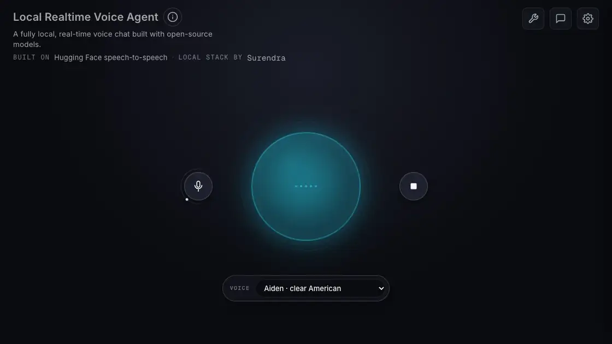

<div align="center">



# Local Realtime Voice Agent

**Talk to an AI that runs entirely on your own computer. No cloud and no API keys.**

[](https://www.python.org/)
[](#quick-start-apple-silicon-mac)
[](#linux-or-wsl2-with-an-nvidia-gpu)
[](./src/speech_to_speech/api/openai_realtime/README.md)
[](./LICENSE)

[Demo](#demo) · [Features](#features) · [How it works](#how-it-works) · [Quick start](#quick-start-apple-silicon-mac) · [Troubleshooting](#troubleshooting) · [License](#license)

</div>

You speak into the browser. A local model transcribes your voice, a second one writes the reply, and a third speaks it back. You can interrupt it mid-sentence.

This project adds an Apple Silicon launcher to Hugging Face's [speech-to-speech](https://github.com/huggingface/speech-to-speech) pipeline, tuned for a Mac with **8 GB of memory**.

## Demo

<p align="center">
  <picture>
    <source media="(prefers-reduced-motion: reduce)" srcset="./media/voice-agent-ui.png">
    
  </picture>
</p>

<p align="center"><sub>Recorded in real time on an M2 Mac with 8 GB of memory. The question was played in by a synthesized voice, and the recording has no sound.</sub></p>

## Features

<table>
  <tr>
    <td width="10%" align="center"></td>
    <td width="40%"><strong>Local inference</strong><br>Speech recognition, the language model, and speech synthesis all run on your machine. Models are downloaded once and cached.</td>
    <td width="10%" align="center"></td>
    <td width="40%"><strong>Natural turn-taking</strong><br>Smart Turn tells a finished sentence from a pause, and you can talk over the assistant to stop it.</td>
  </tr>
  <tr>
    <td width="10%" align="center"></td>
    <td width="40%"><strong>Voice picker</strong><br>Pick from nine voice options in the browser.</td>
    <td width="10%" align="center"></td>
    <td width="40%"><strong>Standard API</strong><br>The server speaks the OpenAI Realtime protocol over WebSocket, with optional WebRTC.</td>
  </tr>
  <tr>
    <td width="10%" align="center"></td>
    <td width="40%"><strong>Swappable parts</strong><br>Change the speech, language, or voice backend with a command-line flag.</td>
    <td width="10%" align="center"></td>
    <td width="40%"><strong>Optional web search</strong><br>Off unless you provide a <a href="https://serper.dev">Serper</a> key. Search queries leave your machine when it is on.</td>
  </tr>
</table>

## How it works

<p align="center">
  
</p>

Each stage runs in its own thread and passes work along through queues.

| Stage | Apple Silicon Mac | Linux / WSL2 + NVIDIA |
|---|---|---|
| Voice detection | Silero VAD | Silero VAD |
| Turn detection | Smart Turn v3.2 | Smart Turn v3.2 |
| Speech to text | Whisper large-v3-turbo, 8-bit (MLX) | Parakeet TDT 0.6B v3 |
| Language model | Qwen3 1.7B, 4-bit (MLX) | Qwen3.5 4B, Q4 GGUF (`llama.cpp`) |
| Text to speech | Kokoro 82M (MLX) | Qwen3-TTS 1.7B CustomVoice, Q8 GGUF |
| Launcher | [`scripts/run_mac.py`](./scripts/run_mac.py) | [`scripts/local_stack.sh`](./scripts/local_stack.sh) |

## Quick start: Apple Silicon Mac

Tested on an M2 with 8 GB of memory and Python 3.11. You need [`uv`](https://docs.astral.sh/uv/) and about 2.5 GB of disk space for the models, plus space for the Python packages.

### 1. Install

```bash
git clone https://github.com/SURISURENDRA18/Speech-to-Speech-Voice-Model.git
cd Speech-to-Speech-Voice-Model

uv sync --python 3.11
uv pip install https://github.com/explosion/spacy-models/releases/download/en_core_web_sm-3.8.0/en_core_web_sm-3.8.0-py3-none-any.whl
```

The last command installs the English language data that Kokoro needs. Run it again after any later `uv sync`, which removes packages that are not listed in the project.

### 2. Start the speech pipeline

```bash
.venv/bin/python scripts/run_mac.py serve \
  --stt mlx-audio-whisper \
  --mlx_audio_whisper_model_name mlx-community/whisper-large-v3-turbo-asr-8bit \
  --enable_live_transcription False \
  --llm_backend mlx-lm \
  --model_name mlx-community/Qwen3-1.7B-4bit \
  --tts kokoro
```

Keep `--enable_live_transcription False`. Live transcription works only with Parakeet, and leaving it on with Whisper cuts off the end of your sentences.

The first run downloads the models. Wait for `Uvicorn running on http://127.0.0.1:8765`.

### 3. Start the browser app

In a second terminal, from the same folder:

```bash
SPEECH_TO_SPEECH_URL=ws://localhost:8765/v1/realtime \
  .venv/bin/uvicorn --app-dir demo server:app --port 7860
```

Open **<http://localhost:7860>**, allow microphone access, and tap the orb. Press `Ctrl+C` in each terminal to stop.

To skip the browser and talk from the terminal, replace step 3 with:

```bash
.venv/bin/speech-to-speech talk --url ws://localhost:8765/v1/realtime
```

### What the Mac launcher changes

`run_mac.py` applies these changes at startup and leaves the pipeline source untouched:

| Change | Why |
|---|---|
| Waits for the GPU lock instead of timing out | Keeps two models from using the GPU at once |
| Caps the MLX buffer cache at 256 MB | Leaves memory free on an 8 GB machine |
| Reuses the prompt cache between turns | Avoids re-reading the whole conversation for each reply |
| Adds light sampling and a repetition penalty | Makes replies less repetitive |
| Limits Whisper decoding and drops looping transcripts | Stops background noise from blocking the pipeline |
| Removes `*`, `#`, and backticks before speech | Keeps Markdown symbols from being read aloud |
| Maps the picker's voice names to Kokoro voices | Makes the browser voice picker work |

<details>
<summary><strong>Voice mapping on the Mac</strong></summary>

The picker lists Qwen3-TTS speakers. On the Mac, each one plays a British English Kokoro voice, so the accents described in the picker apply only to the Linux stack.

| Picker | Kokoro voice |
|---|---|
| Aiden | `bm_fable` |
| Ryan | `bm_george` |
| Dylan | `bm_daniel` |
| Eric | `bm_lewis` |
| Uncle Fu | `bm_george` |
| Serena | `bf_emma` |
| Vivian | `bf_isabella` |
| Sohee | `bf_alice` |
| Ono Anna | `bf_lily` |

</details>

## Linux or WSL2 with an NVIDIA GPU

This stack comes from [gkintu/hf-speech-to-speech](https://github.com/gkintu/hf-speech-to-speech), whose author tested it on Ubuntu under WSL2 with an RTX 5060 Ti. You need Ubuntu 24.04 or newer (glibc 2.39), `uv`, `curl`, and a CUDA build of [`llama.cpp`](https://github.com/ggml-org/llama.cpp) with `llama-server` on your `PATH`.

<details>
<summary><strong>Setup steps</strong></summary>

Clone the repository and install it:

```bash
git clone https://github.com/SURISURENDRA18/Speech-to-Speech-Voice-Model.git
cd Speech-to-Speech-Voice-Model
uv sync --python 3.11
```

Download the models. Parakeet downloads itself on first use.

```bash
uv tool install huggingface_hub
mkdir -p models/llm models/qwen3-tts models/smart-turn-v3

hf download unsloth/Qwen3.5-4B-GGUF \
  Qwen3.5-4B-UD-Q4_K_XL.gguf \
  --local-dir models/llm

hf download FindaDeath/Qwen3-TTS-GGUF \
  qwen-talker-1.7b-customvoice-Q8_0.gguf \
  qwen-tokenizer-12hz-Q8_0.gguf \
  --local-dir models/qwen3-tts

hf download pipecat-ai/smart-turn-v3 \
  smart-turn-v3.2-cpu.onnx \
  --local-dir models/smart-turn-v3
```

The launcher already expects these paths. To change paths, ports, devices, or the default voice, copy the example settings and edit them:

```bash
cp .env.example .env
```

Start all three services, then open <http://localhost:7860>:

```bash
./scripts/local_stack.sh run
```

To run in the background instead:

```bash
./scripts/local_stack.sh start
./scripts/local_stack.sh status
./scripts/local_stack.sh logs
./scripts/local_stack.sh stop
```

</details>

## Endpoints

| Service | Address | Used on |
|---|---|---|
| Browser app | `http://localhost:7860` | Both |
| Realtime API | `ws://localhost:8765/v1/realtime` | Both |
| `llama-server` | `http://localhost:8080/v1` | Linux / WSL2 |

All of them listen on your own machine only by default. The Realtime server has no authentication, so put a gateway in front of it before exposing it to a network.

## Other backends

| Flag | Choices |
|---|---|
| `--stt` | `parakeet-tdt`, `mlx-audio-whisper`, `whisper`, `whisper-mlx`, `faster-whisper`, `paraformer`, `none` |
| `--llm_backend` | `mlx-lm`, `transformers`, `responses-api`, `chat-completions` |
| `--tts` | `kokoro`, `qwen3`, `svara`, `pocket`, `chatTTS`, `facebookMMS` |

Some need an extra, for example `uv sync --extra faster-whisper`. The extras are listed in [`pyproject.toml`](./pyproject.toml). `responses-api` and `chat-completions` connect to a server you choose, so they are local only if that server is.

More detail: [speech to text](./src/speech_to_speech/STT/README.md) · [language models](./src/speech_to_speech/LLM/README.md) · [text to speech](./src/speech_to_speech/TTS/README.md) · [Realtime API](./src/speech_to_speech/api/openai_realtime/README.md) · [browser app](./demo/README.md)

For Indian languages, set `S2S_STT=whisper` and `S2S_TTS=svara` in `.env` (see [`.env.example`](./.env.example)). To run it on a server with a login, see [`deploy/gcp`](./deploy/gcp/README.md).

## Project layout

```text
├── demo/                     Browser app
├── deploy/gcp/               Server deployment on a GCP L4
├── scripts/
│   ├── run_mac.py            Apple Silicon launcher
│   ├── local_stack.sh        Linux / WSL2 launcher
│   └── benchmark_*.py        Speech benchmarks
├── src/speech_to_speech/
│   ├── VAD/                  Voice and turn detection
│   ├── STT/                  Speech to text
│   ├── LLM/                  Language models
│   ├── TTS/                  Text to speech
│   ├── pipeline/             Messages, cancellation, turn tracking
│   └── api/openai_realtime/  WebSocket and WebRTC server
├── tests/
├── LICENSE
└── NOTICE
```

## Troubleshooting

| Problem | Fix |
|---|---|
| Kokoro fails with `No module named pip` or an `en_core_web_sm` error | Run the `uv pip install` command from step 1 again |
| The end of your sentence is missing | Start the pipeline with `--enable_live_transcription False` |
| The browser never asks for the microphone | Use `http://localhost:7860`. Browsers block the microphone on plain `http://` addresses other than localhost |
| The orb does not connect | Check that the pipeline is running and that `SPEECH_TO_SPEECH_URL` uses the same port |
| Replies are slow on an 8 GB Mac | Close other large apps, or try `--model_name mlx-community/Qwen3-0.6B-4bit` |
| WebRTC returns a 501 error | Run `uv sync --extra webrtc`, then repeat the `uv pip install` command on a Mac |

## Development

```bash
uv sync --python 3.11 --group dev
uv run pytest
uv run ruff check src/ tests/
uv run mypy src/
```

## Credits

- **[Hugging Face speech-to-speech](https://github.com/huggingface/speech-to-speech)**: the speech pipeline, Realtime server, and browser app.
- **[George Kintu](https://github.com/gkintu/hf-speech-to-speech)**: the Linux/NVIDIA stack and voice picker this repository started from.
- **[Surendra](https://github.com/SURISURENDRA18)**: the Apple Silicon launcher and the changes to the browser app listed in [NOTICE](./NOTICE).

## License

Licensed under the [Apache License 2.0](./LICENSE). You may use, modify, and distribute this code, including commercially, as long as you follow the license terms and keep the notices in [NOTICE](./NOTICE).

Model weights are not included and have their own licenses:

| Model | License |
|---|---|
| [Silero VAD](https://github.com/snakers4/silero-vad) | MIT |
| [Smart Turn v3](https://huggingface.co/pipecat-ai/smart-turn-v3) | BSD 2-Clause |
| [Whisper large-v3-turbo](https://huggingface.co/openai/whisper-large-v3-turbo) | MIT |
| [Qwen3 1.7B](https://huggingface.co/Qwen/Qwen3-1.7B) | Apache 2.0 |
| [Kokoro 82M](https://huggingface.co/hexgrad/Kokoro-82M) | Apache 2.0 |
| [Parakeet TDT 0.6B v3](https://huggingface.co/nvidia/parakeet-tdt-0.6b-v3) | CC BY 4.0 |
| [Qwen3.5 4B GGUF](https://huggingface.co/unsloth/Qwen3.5-4B-GGUF) | Apache 2.0 |
| [Svara TTS v1](https://huggingface.co/kenpath/svara-tts-v1) | Apache 2.0 |
| [SNAC 24 kHz](https://huggingface.co/hubertsiuzdak/snac_24khz) | MIT |
| [Qwen3-TTS 1.7B CustomVoice](https://huggingface.co/Qwen/Qwen3-TTS-12Hz-1.7B-CustomVoice) | Apache 2.0 |

<p align="center">
  
</p>
